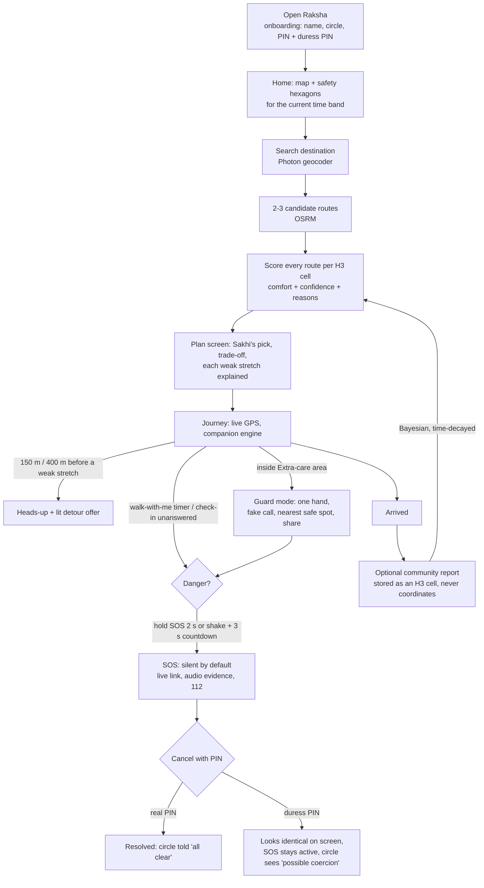
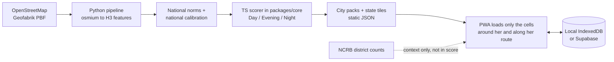
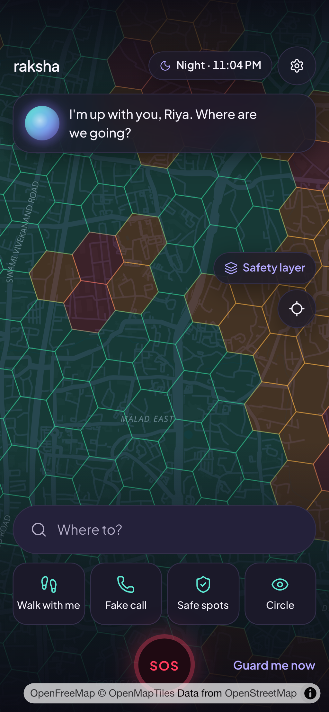
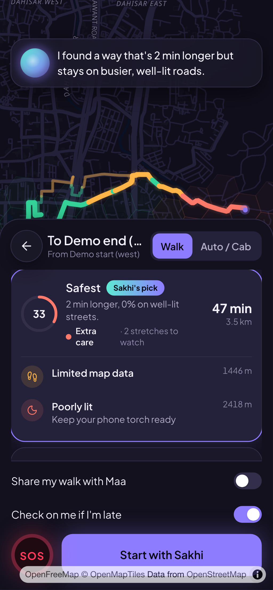
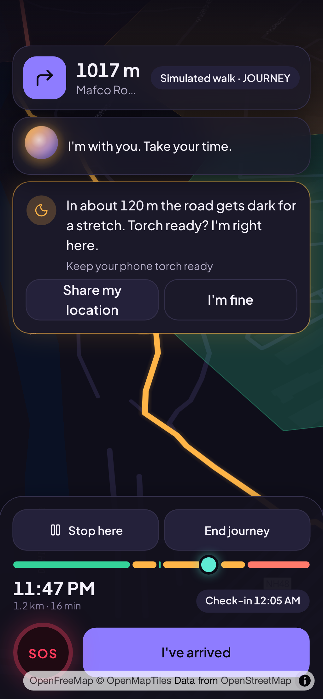
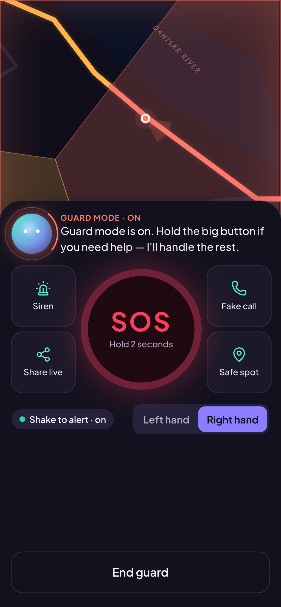
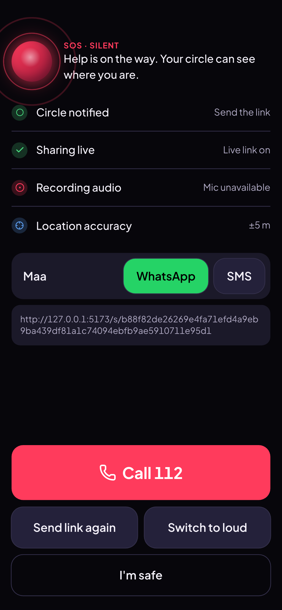
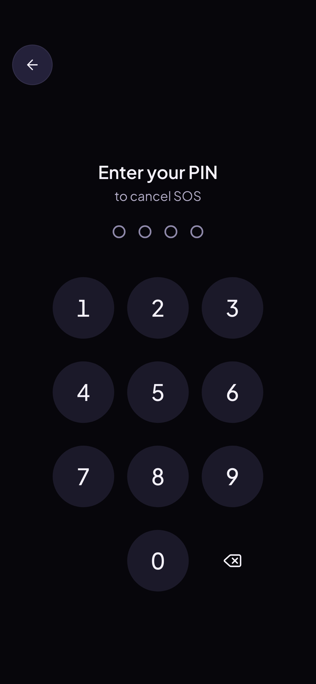
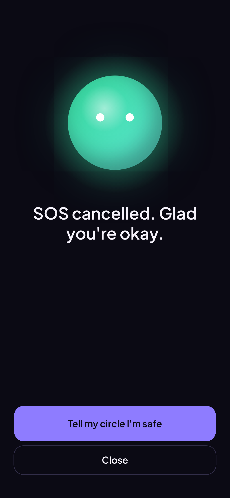
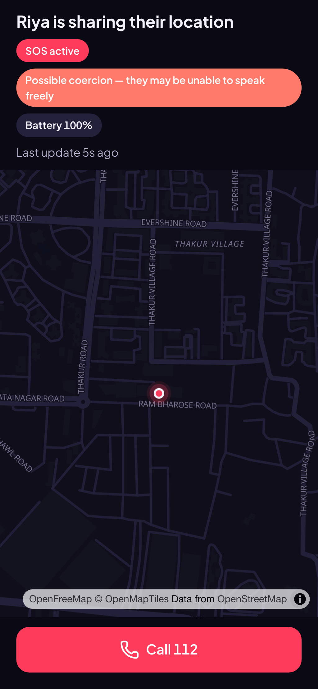

# Raksha — a companion that walks with you

**HackOverflow 10.0 (NIT Durgapur) · Open Innovation.** Raksha warns a woman about low-comfort stretches *before* she reaches them, routes her through better-lit, busier streets, and switches to a one-hand **Guard** mode when she is inside a risky area. Its companion, **Sakhi**, is a calm animated orb that speaks in short, specific lines.

> Raksha helps you stay aware; it can't guarantee safety. In danger, call **112**.

**▶ Demo video:** [`docs/demo.webm`](docs/demo.webm) (onboarding → plan → weak-stretch reasons → hold-to-SOS)

## The problem and our answer
Women plan around "is that road lit, is it empty, is there help nearby?" every evening, but maps only optimise for *fast*. Existing safety apps are mostly an SOS button after something has gone wrong. Raksha works **before** (route choice and heads-ups), **during** (Guard mode, live share, fake call) and **at the moment of danger** (silent SOS with a duress PIN), and every score comes with a reason a person can read.

## How it all fits together




| Home & hex reasons | Plan (3 routes) | Heads-up | Guard |
|---|---|---|---|
|  |  |  |  |

| SOS (silent) | PIN cancel | Cancelled (real **and** duress look identical) | Contact's live view |
|---|---|---|---|
|  |  |  |  |

## Try it
**Hosted:** deploy to any free HTTPS static host (see [`docs/DEPLOY.md`](docs/DEPLOY.md)); on a phone, open the site and "Add to Home Screen". HTTPS is required for GPS, the service worker and motion sensors.

**From the prebuilt zip (no installs beyond Python 3 or Node):**
```bash
./start-demo.sh          # macOS / Linux   (Windows: start-demo.bat)   → http://localhost:4173
```
**From source** (Node 20+, pnpm): `pnpm i && pnpm build && pnpm preview`, or `pnpm dev`.

It starts in **local mode** (no accounts, everything on the device). Add Supabase keys (`.env.example`) for accounts, cross-device live sharing, evidence upload and shared community reports.

### Evaluating it without walking at night
Real use needs your real location and the real clock. To exercise the night-time behaviour at a desk: **Settings → Test mode** (off by default) reveals *Pretend it's* (Day / Evening / Night), a **Simulate walk** button on the route screen (1×–40× speed, with realistic GPS noise), and *Simulate shake*. Then search for a destination near the city you are testing: the app fetches live routes (OSRM) and places (Photon), so you need a network connection. Nothing is pre-recorded.

## What it does
1. **Plan** — search a destination (or choose a start point); Raksha fetches 2–3 routes, scores each for the *current time band*, recommends one, and explains each weak stretch with a plain reason and a tip.
2. **Warn** — ~150 m (walk) / 400 m (vehicle) before a weak stretch Sakhi gives a heads-up and, if one exists, offers a lit detour.
3. **Guard** — inside an Extra-care area the UI becomes one-handed: hold-to-SOS (2 s), siren, share live location, fake call, nearest safe spot; left/right-hand layout.
4. **SOS** — silent by default (loud adds a siren), a live link for her circle, audio evidence, one-tap 112. Cancelling needs a PIN; a **duress PIN** shows the same "cancelled" screen but keeps the SOS active and tells the circle "possible coercion". Shake-to-SOS has a 3 s cancellable countdown. A walk-with-me timer and "are you okay?" check-ins escalate if she doesn't answer.
5. **Built for bad networks** — SOS positions and the cancel/resolve call queue and retry until the backend accepts them (a duress flag survives a reload); if the SOS session can't be created at first, the screen still works (112 / SMS links) while it retries.
6. **Real coverage, state-wide** — dense city packs for Mumbai, Delhi NCR, Bengaluru, Pune, Kolkata, Hyderabad, Chennai and Durgapur, plus a **state-wide tile pipeline for Maharashtra, Madhya Pradesh and West Bengal** (`pipeline/build_regions.sh`; states whose tiles have finished building are listed in `apps/web/public/data/regions.json`), all built from OpenStreetMap on one national calibration so a cell's class never depends on which file it came from. The app loads only the tile under her and its neighbours, plus tiles along a planned route. Outside coverage, routes still work and are scored cautiously ("limited data"), never shown as comfortable.
7. **Accounts & languages** — anonymous by default, with an optional email upgrade so her circle follows her to a new phone; English and Hindi.

## How the safety score works
Explainable, not a black box: OpenStreetMap features per H3 hexagon (lighting, openness, activity, help nearby, transit, isolation) → a weighted score per time band with a confidence and reasons → community reports adjust it (Bayesian, time-decayed). It never claims a place *is* safe. Full details and the calibration numbers: [`docs/SCORING.md`](docs/SCORING.md).

## Architecture
```
apps/web        React 19 + TS + Tailwind v4 + Motion + MapLibre PWA (local mode by default)
packages/core   pure TypeScript: scoring, route analysis, companion state machine, shake, PIN hashing, messages (124 tests, 99% lines)
pipeline        Python: Overpass → H3 features → safe spots → calls the TS scorer to export cells.json
supabase        optional backend: migrations, RLS, RPCs, edge functions, pgTAP tests, seeds
docs            SCORING.md, DEPLOY.md, DECISIONS.md, screenshots
```
- **Local mode:** no keys → IndexedDB backend; the contact view works across tabs of the same browser.
- **Supabase mode:** set `VITE_SUPABASE_URL` + `VITE_SUPABASE_ANON_KEY` (see `.env.example`) for cross-device live sharing, evidence upload and shared reports. Setup: [`supabase/README.md`](supabase/README.md).
- **City data:** `pnpm pipeline:run --city all` builds the packs from Geofabrik extracts with osmium (see `docs/DEPLOY.md`); a monthly GitHub workflow refreshes them.

## Future prospects
- **Native apps** (Android first): power-button / volume SOS, background geofencing, automatic SMS, recording that survives a closed screen.
- **More states**: the region pipeline is config-driven (`pipeline/config/regions.yaml`), so each new state is one entry plus a Geofabrik zone and a build run.
- **Better data**: fuse street-light and CCTV datasets from municipal open-data portals, VIIRS night-light imagery and crowd-sourced "lit / busy right now" check-ins, and validate scores against ground-truth walks with partner NGOs.
- **Community & institutions**: moderated reports with trusted-reporter weighting, verified safe spots (shops, pharmacies, police booths), an anonymised heatmap for city planners and campus security.
- **Offline-first maps** and Hindi, Bengali and Marathi voice for Sakhi; more Indian languages.
- **Per-trip safety briefing** shared with the circle, and ride-hail integration (share the cab route and alert on deviation).
- **Production hardening**: end-to-end run on a full Supabase stack, push fan-out tests, a third-party security review.

## Tests
```bash
pnpm check              # typecheck + lint + unit tests (core 126, web 19)
pnpm pipeline:test      # pytest (16, includes a real osmium round trip)
pnpm test:e2e           # Playwright (mocked routing/geocoding, own ports, keys blanked): hero flow, real-use, Hindi, accessibility (axe), offline/PWA/CSP
pnpm db:verify-local    # migrations + 101 pgTAP assertions on a throwaway local PostgreSQL (no Docker)
pnpm db:test            # the same pgTAP files via `supabase test db` (needs Docker + Supabase CLI)
pnpm functions:test && pnpm functions:check   # Deno: edge-function checks
```

## Privacy & security
- **Location stays on the device** except while she is actively sharing or in an SOS. Reports are stored as an H3 cell, never as coordinates. No analytics, no third-party trackers.
- PIN and duress PIN are hashed on the device (PBKDF2-SHA256, 150k iterations, random salt) and never sent anywhere.
- Share links carry a 256-bit token; only its sha256 is stored; links expire. Contacts read through a rate-limited edge function; invalid tokens answer 404 with no detail.
- Row-level security on every table (anonymous visitors have no table privileges); writes that need validation go through RPCs; pgTAP proves cross-user isolation. Anon key only in the client.
- Strict CSP in production builds, `Referrer-Policy: no-referrer`, `pnpm audit` and `pip-audit` clean of known vulnerabilities, "Delete all my data" in Settings.

## Honest limitations
- **A web app cannot do what a native app can.** Tracking and shake only work while the app is open (the screen is kept awake in Journey/Guard); browsers can't send SMS automatically, so SOS hands her a share sheet / WhatsApp / SMS links; power-button or volume triggers and background geofencing need the native app (roadmap).
- **Estimates, not facts.** OSM lighting and opening-hours tags are sparse in India; many scores rest on priors, which is why confidence is shown and low-confidence cells are scored conservatively. Open data cannot see crowds, CCTV or tonight's power cut.
- OSM walking alternatives are often near-identical, so the main value is the weak-stretch warnings and Guard rather than a dramatic safest-vs-fastest gap.
- The Supabase backend is verified against plain PostgreSQL + PostGIS with pgTAP and a mutation check, and the edge functions are type-checked, but it has **not yet been run against a full Supabase stack** (no Docker on the dev machine). Report distance checks trust the position the client sends (best-effort anti-spam).
- **NCRB** shows district-level context only (Home → "District data", and an Insights comparison of the covered cities). It is *registered cases* in selected categories, as counts not rates (the source file has no population), and it is deliberately **not** part of the street-level safety score: a district count says nothing about a particular street, and more cases can mean easier reporting. There is no district choropleth map. Web-push fan-out is implemented server-side but untested end to end.
- Evidence recording stops if the tab is closed.

## Data & attributions
District context: **NCRB, Crime in India** (via the India Data Portal). Map data © **OpenStreetMap contributors** (ODbL). Routing by **FOSSGIS / OSRM**. Base tiles by **OpenFreeMap**. Place search by **Photon (Komoot)**. Icons: Lucide. Font: Plus Jakarta Sans. Safety scores are derived from OSM; they are estimates and conditions can change.

## Team
**Team Caffeinated Compilers**

- Siddhi Lakhotia (team leader)
- Vaibhav Dohare
